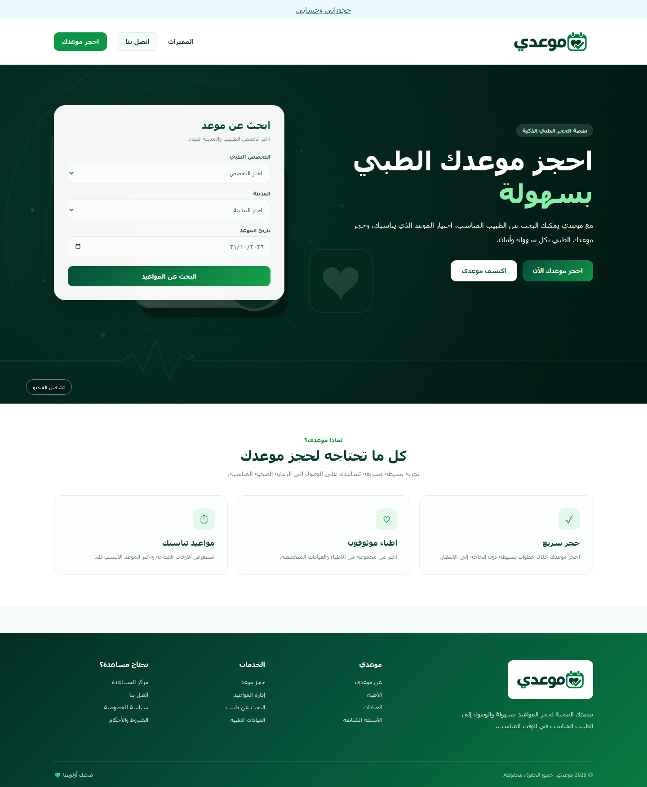
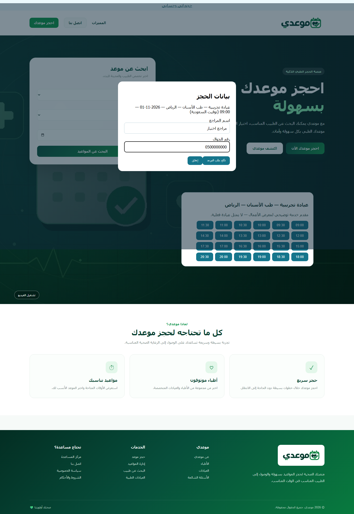

# Mawidi — Appointment Scheduling

## Overview

Arabic Django appointment scheduler with specialty/city search, shared availability, private booking history and transaction-protected conflict checks.

The customer-facing interface remains Arabic and RTL. This repository is independent; its current directory and GitHub repository name have not been changed.

## Features

- Search fictional provider resources by specialty, city and date.
- Shared server-side availability rather than per-browser bookings.
- Account registration, private booking history and future-booking cancellation.
- Server validation of dates, service duration and provider/service relationships.
- Idempotent booking submission and transaction-protected overlap checks.
- Staff confirmation/completion and responsive Arabic booking forms.

## Tech Stack

- Python
- Django
- SQLite and Django ORM
- Native Django JSON endpoints
- HTML, CSS and JavaScript
- python-dotenv
- Git

Testing uses Django's test runner and Playwright. The JSON endpoints, where present, use native Django views; Django REST Framework is not installed.

## Screenshots

All captures use fictional demonstration data.

<details>
<summary>View verified interface screenshots</summary>






</details>

## Installation

Tested on Windows with Python 3.14 and Django 6.1.2. From this repository:

```powershell
python -m venv .venv
.\.venv\Scripts\python.exe -m pip install -r requirements.txt
```

On macOS/Linux, use `.venv/bin/python` in place of `.\.venv\Scripts\python.exe` in the commands below. No OS execution-policy change is required.

## Setup

`run_demo.py` creates a separate `.local/demo.sqlite3`, a locally generated development secret and fictional demo catalog/resources as appropriate. It never migrates the original root `db.sqlite3`. Re-running it preserves the demo database and does not reset existing records. No default customer or administrator password is shipped.

Direct Django commands read configuration from process environment and `.env` through `python-dotenv`. An optional local configuration file can be created without overwriting an existing one:

```powershell
if (-not (Test-Path .env)) { Copy-Item .env.example .env }
```

Keep real values in `.env` or process environment. `DJANGO_SECRET_KEY` must be persistent for ordinary long-running use. `DJANGO_DEBUG=0` requires an explicit secret and separate HTTPS/host/email configuration. `DJANGO_DB_PATH` selects a database for direct `manage.py` commands; do not point migration commands at personal data without first testing a backup.

## Running the Project

```powershell
.\.venv\Scripts\python.exe run_demo.py
```

Open **http://127.0.0.1:8105**. Register your own customer account.

```powershell
# Prepare the isolated demo without starting a server
.\.venv\Scripts\python.exe run_demo.py --prepare-only
# Interactively create an administrator in the isolated demo database
.\.venv\Scripts\python.exe run_demo.py --create-admin --prepare-only
```

The administrator URL is **`/admin/`**. The launcher supports `--port` and binds to localhost. Stop with Ctrl+C.

## Testing

```powershell
.\.venv\Scripts\python.exe -m pip install -r requirements-dev.txt
.\.venv\Scripts\python.exe -m playwright install chromium
.\.venv\Scripts\python.exe manage.py check
.\.venv\Scripts\python.exe manage.py test --noinput
.\.venv\Scripts\python.exe manage.py makemigrations --check --dry-run
.\.venv\Scripts\python.exe scripts/browser_check.py
```

Django tests use a test database. The browser check starts a temporary database and localhost server, creates disposable accounts and blocks external browser requests. It does not use the original or demo database. Outputs go to ignored `test-results/`.

The browser check includes cross-account ownership, shared availability and simultaneous booking-conflict checks.

## Project Structure

- `accounts/` — Authentication, profile forms, routes and tests.
- `booking/` — Domain models, validation, services, routes and tests.
- `config/` — Django settings and root URLs.
- `templates/ and static/` — Arabic account and application pages.
- `scripts/browser_check.py` — Isolated end-to-end verification.
- `run_demo.py` — Non-destructive local demo launcher.

## API

| Method | Route | Authentication / behavior |
|---|---|---|
| GET | `/api/session/` | Session state; sets a CSRF cookie |
| GET | `/api/resources/` | Public active resources/services; optional city/specialty filters |
| GET | `/api/availability/` | Public free/busy times for a resource, service and date |
| GET | `/api/bookings/` | Signed-in user's bookings only |
| POST | `/api/bookings/create/` | Validated, idempotent booking creation |
| POST | `/api/bookings/<id>/cancel/` | Cancel an owned future active booking |

Availability parameters include `resource`, `service` and `date=YYYY-MM-DD`; car-care requests may also include vehicle/add-on options. Creation requires a UUID `token`, resource/service, date/time, customer and phone. Invalid fields return 400; conflicts return 409. Public availability does not expose customer contact details.

| Method | Route | Response / purpose |
|---|---|---|
| GET / POST | `/accounts/signup/` | Registration form / account creation |
| GET / POST | `/accounts/login/` | Login form / session authentication |
| POST | `/accounts/logout/` | End the session |
| GET / POST | `/accounts/` | Read / update the signed-in profile |
| GET / POST | `/accounts/password/` | Validated password change |

Unsafe Django API requests require `X-CSRFToken` from the CSRF cookie plus the session cookie. Resource management and booking status actions are available only through staff administration.

## Data, Security and Scope

- Databases, `.env`, `.local/`, virtual environments, media uploads and test outputs are ignored by Git.
- Demo seeds add missing fictional catalog/resources; they do not create users or reset records.
- This is a local portfolio application, not a preconfigured public production deployment.
- No payment gateway, automatic WhatsApp/SMS delivery or production email service is configured.
- Demo clinics/resources are fictional and do not represent real medical appointments. The app collects scheduling/contact details, not medical histories.
- The optional `media/create_hero_video.py` regeneration tool uses `requirements-assets.txt`; these dependencies are not needed to run the website. It is not run during application tests.

## Future Improvements

- Add per-provider opening hours and time-off management.
- Add reminders through a configured provider and explicit delivery tracking.
- Add PostgreSQL integration tests and an OpenAPI schema.

## Source

[Mawidi on GitHub](https://github.com/tayma-ops/ivery2). Maintenance notes: [PUBLISHING.md](PUBLISHING.md).

## Author

Atallah Alrashoud

GitHub: [tayma-ops](https://github.com/tayma-ops)
